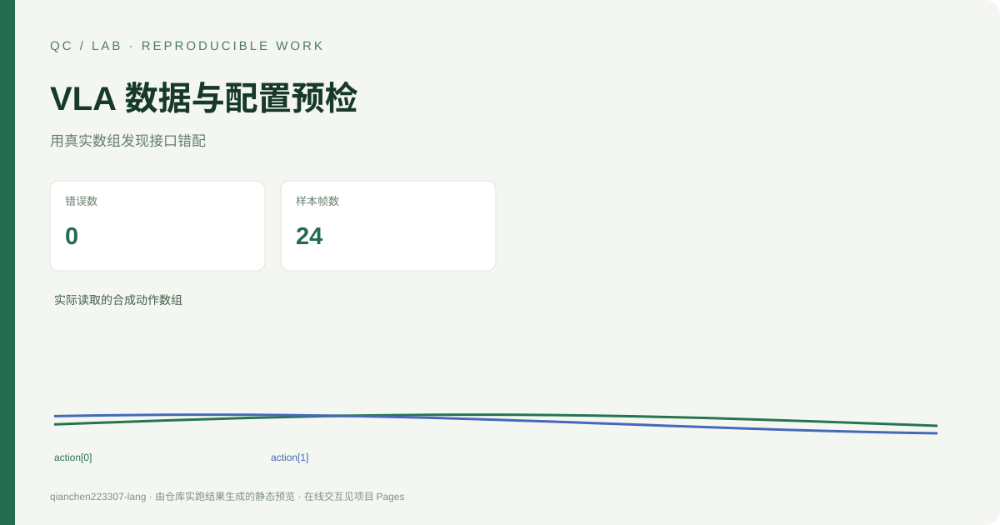

# VLA 数据与配置预检



[在线交互演示](https://qianchen223307-lang.github.io/vla-data-preflight/) · [实验与样例结果](results/) · [验证流程](.github/workflows/ci.yml)


[在线演示](https://qianchen223307-lang.github.io/vla-data-preflight/) · [English](README.en.md) · [接口来源](SOURCES.md)

独立实现的 CPU 工程工具：针对 **StarVLA LIBERO / QwenOFT 的有限数据契约**，在训练前核对 YAML、LeRobot 元数据、modality 和真实数组样本。我的新增内容是规则、CLI、实际数组适配器、诊断报告、测试与演示；没有复制 StarVLA 代码或声称参与其研究。

展示数据是本仓库生成的合成输入。工具不下载权重、不执行注册脚本、不启动仿真或模型，不宣称提高成功率或量化节电。

## 安装与运行

Python 3.10+，仓库根目录运行：

```bash
python -m pip install -e .
python -m vla_data_preflight demo
python -m unittest discover -s tests -v
python -m vla_data_preflight check --config fixtures/valid/train.yaml --info fixtures/valid/dataset/meta/info.json --modality fixtures/valid/dataset/meta/modality.json --samples fixtures/valid/samples.npz --base-dir fixtures/valid --output results/check-valid
```

把四个输入路径替换成用户实际文件即可。`--base-dir` 是训练进程用于解析 `data_root_dir` 的工作目录，默认当前工作目录，而非 YAML 文件目录。检查器只读输入，输出到 `--output`。如果复制 `samples.npz`，必须同时使用对应的实际元数据。

## 四个输入及明确边界

1. 训练 YAML：`framework.name=QwenOFT`、`action_dim=7`、`dataset_py=lerobot_datasets`、本地 `data_root_dir`、非空 `data_mix`、正整数 batch/步数/梯度累积、有效 warmup 和正有限 base 学习率。`include_state=true` 时要求配置 `state_dim=8`；不使用 state 时不因上游未使用的 state_dim 参数而误报。
2. 原生 `meta/info.json`：`features.action.shape=[7]`、`features.observation.state.shape=[8]`；选中图像 feature 为 `image/video`，依照 `names` 中的 height/width/channel(s) 解析 `shape`，支持命名 CHW/HWC 元数据；`fps` 正且有限。快照始终使用解码后 HWC。
3. 原生 `meta/modality.json`：action/state 命名切片必须在范围内且无重叠/空缺；video 的 `original_key` 必须精确映射到 info feature；annotation 是扁平键 `human.action.task_description`，其 `original_key=task_index`。
4. **本工具定义的 samples.npz 快照适配器**：存储已经从真实 LeRobot 样本抽出的实际数组，不是 LeRobot 原生存储格式，不是 shape 描述 JSON。

NPZ 键为 `action [T,7]`、`observation.state [T,8]`、每个 modality.video 的 original_key（实际 `uint8 [T,H,W,3]` 像素）、`lang [T]`（解析后的非空 Unicode 指令）、`task_index [T]`（非负整数）。所有数组 T 相同且非空，向量有限。快照保留 state 供接口审阅，即使模型当前不使用它。

已有真实数据读取流程可在抽样后导出：

```python
import numpy as np

# 以下变量应由你现有的数据读取器提供，不能用占位符代替真实数组。
np.savez_compressed(
    "samples.npz",
    **{
        "action": action_array,                      # [T,7]
        "observation.state": state_array,            # [T,8]
        "observation.images.image": head_pixels,     # [T,H,W,3], uint8
        "observation.images.wrist_image": wrist_pixels,
        "lang": np.asarray(resolved_instructions, dtype=str),
        "task_index": np.asarray(task_indices, dtype=np.int64),
    },
)
```

本版本不直接解析 LeRobot 的 Parquet/MP4；不动态执行 `data_config.py`，因此只能确认 `data_mix` 为非空字符串，**不能证明注册表名称存在或相机语义正确**。不检查 Hugging Face checkpoint 是否存在。原生 key 与原始样本表示参考 [SOURCES.md](SOURCES.md) 的固定提交。

仓库 fixtures 是最小接口样例，不是完整可训练的 LeRobot 数据集或训练配置。通过预检只表示满足这里明示的规则，不表示上游训练一定启动成功。

## 可审阅的结果

输出 `report.json` / `report.html`；每条诊断有 `check_id,severity,path,message,hint`。退出码 `0` 通过、`1` 输入/数据检查失败、`2` CLI 参数错误。安全读取使用 `yaml.safe_load` 和 `np.load(...,allow_pickle=False)`；不会载入 NPZ object/pickle 数组。报告动作曲线最多保留前 256 帧，快照中的数组仍全部检查。

实际 demo 报告见 `results/summary.json`：正常样例 0 error；异常样例 6 error，分别对应 warmup、切片重叠、相机映射、Inf、图像长度、空语言。`docs/data.json` 是前端结果展示契约，数据来自同次实际 Python 运行。

本次 Python 3.12.14 实跑：18 项测试通过；正常/异常输入的实际模块 CLI 退出码分别为 0/1。记录见 `results/verification.json` 和 `results/test-results.xml`。

## 贡献与局限

该项目展示配置核验、数据契约建模、边界处理与回归测试能力。它是独立工程工具，不是 StarVLA 模型复现；没有完整数据集审计、机器人实验、硬件能耗或模型成绩。有限快照不能证明整个数据集质量，帧长一致不等于传感器同步。AI 辅助范围见 [AI_USE.md](AI_USE.md)。

## 固定环境与验证

使用 Python 3.12。锁文件包含开发、构建及跨平台运行依赖，首次安装后即可复跑：

```bash
python -m venv .venv
# Windows: .venv\Scripts\activate
# macOS / Linux: source .venv/bin/activate
python -m pip install -r requirements.lock
python -m pip install --no-build-isolation --no-deps -e .
python -m pytest -q
python -m vla_data_preflight demo
```

Pages 目录为 `docs/`，包含可直接打开的独立 HTML。交互展示读取已计算结果；完整计算在本地 Python 运行。构建时的来源、数据类型和实验局限见本文及来源文档。

更新演示数据后，执行 `python scripts/build_site.py` 重建独立网页。静态结果预览对应本仓库已记录的完整实验；重新计时会因机器与系统负载不同而变化。
